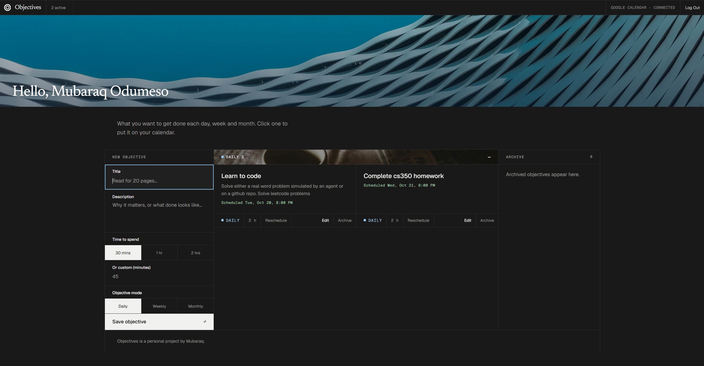

<p align="center">
  
</p>

<h1 align="center">Objectives</h1>

<p align="center">
  Set daily, weekly and monthly objectives and schedule them on Google Calendar.
</p>



## Requirements

- Python 3.11 or newer
- Node.js 22 (see `frontend/.nvmrc`)
- A [Neon](https://neon.com) account
- A Google Cloud project, only needed for Google sign-in and Calendar

## Setup

### 1. Database

Sign in to Neon, then create the environment variables from the project.

```bash
cd backend
npm i -g neon@latest
neon login
neon deploy
```

This writes `DATABASE_URL` and `DATABASE_URL_UNPOOLED` into `backend/.env`.

### 2. Backend

```bash
cd backend
python -m venv venv
source venv/bin/activate
pip install -r requirements.txt
cp .env.example .env    # skip if neon deploy already created it, then add the other values
alembic upgrade head
fastapi dev
```

Set `SECRET_KEY` in `backend/.env` first.
Generate one with `python -c "import secrets; print(secrets.token_urlsafe(32))"`.

The API runs at <http://localhost:8000>, and the docs are at <http://localhost:8000/api/v1/docs>.

### 3. Frontend

```bash
cd frontend
npm install
cp .env.example .env.local
npm run dev
```

The app runs at <http://localhost:3000> and calls the API at <http://localhost:8000> directly, so start both.
Keep both on `localhost`: the refresh cookie is `SameSite=Lax`, so they must be same-site.

### 4. Google sign-in and Calendar (optional)

Follow [backend/GOOGLE_SETUP.md](backend/GOOGLE_SETUP.md), then add the client ID and secret to `backend/.env`.
Everything else works without it.

## Checks

```bash
cd backend && pytest && ruff check .
cd frontend && npm run lint && npm run typecheck && npm test
```

More detail lives in [backend/README.md](backend/README.md).
